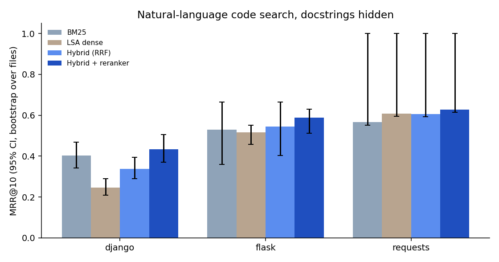

# coderag — code-aware search and cited Q&A, with an evaluation harness

[](https://github.com/shanchacko7829/codesearch-rag/actions)

Ask a question in plain English, get the functions in a Python codebase that answer it, with file and line numbers. Retrieval is built from scratch (AST chunking, BM25, LSA embeddings, rank fusion, a learned reranker). The part most projects skip: **a benchmark that measures whether each piece actually helps**, with confidence intervals.



## Results (measured, reproducible with `python -m coderag eval`)

Benchmark: for each documented function, the first paragraph of its docstring is the query, and the function's location is the answer. The index is built with **docstrings hidden**, so the retriever must link English to identifiers and code. Train/test split is **by file** (the reranker never sees test files). Pinned repos: Flask 3.1.3, Requests 2.32.5, Django 5.2.6.

**Django is the main result**: 10,135 chunks, 646 test queries from 86 files. MRR@10 with 95% CI (bootstrap over files):

| Method | MRR@10 | Hit@1 | Hit@10 | p50 latency |
|---|---|---|---|---|
| LSA dense | 0.246 [0.208, 0.291] | 0.166 | 0.455 | 0.85 ms |
| Hybrid (RRF of BM25 + dense) | 0.338 [0.290, 0.394] | 0.246 | 0.564 | 0.88 ms |
| BM25 | 0.402 [0.342, 0.468] | 0.294 | 0.644 | 0.27 ms |
| Hybrid + learned reranker | **0.434** [0.370, 0.505] | 0.328 | 0.661 | 1.43 ms |

What the paired tests say (difference in MRR@10, 95% CI):
* **Hybrid is worse than plain BM25 on Django** (−0.064, CI [−0.098, −0.028]). The LSA embeddings are weak on a 10k-chunk corpus, and fusing a weak signal with a strong one hurts. I report this rather than hide it.
* **The reranker fixes it**: +0.096 over hybrid (CI [0.061, 0.131]), and it ends above BM25 (0.434 vs 0.402), though the two intervals overlap, so that last gap is not proven.
* **AST chunking beats fixed 40-line windows** for BM25: 0.402 vs 0.344. For hybrid the gap is small (0.338 vs 0.331).

Limits of this benchmark:
* **77% of Django queries share a word with the function's name**, which makes the task easier than real user questions. On the 147 queries with no shared word, MRR@10 is only 0.18 (BM25) / 0.19 (reranker). Genuine semantic matching is still weak.
* **Flask (63 queries, 5 files) and Requests (28 queries, 2 files) are too small for reliable conclusions.** Their numbers are in `results/`, but the confidence intervals are wide (Requests has only 2 test files, so its CI is meaningless). Treat them as sanity checks.
* A reranker trained on Django and applied to Flask scored 0.575 vs 0.589 when trained on Flask itself, so it transfers reasonably, but with 5 test files I can't claim more.
* Dense retrieval is LSA (SVD over term counts), **not a neural model**. A `sentence-transformers` backend is included (`--backend sbert`) but I did **not** benchmark it.
* Queries are docstrings, not real developer questions. Python only.

## How it works

1. **Chunking** (`chunker.py`): parse with `ast`; one chunk per function, method, class header, and module top-level. Long functions are split into overlapping parts. Files that fail to parse fall back to line windows.
2. **Tokenising** (`text.py`): split `snake_case` and `camelCase`, light stemming, keep the full identifier too; function names are boosted ×2.
3. **BM25** (`bm25.py`): from scratch on a scipy sparse matrix.
4. **Dense** (`dense.py`): TruncatedSVD (LSA), 256 dims.
5. **Fusion** (`index.py`): reciprocal rank fusion, k=60.
6. **Reranker** (`rerank.py`): logistic regression over 15 features (BM25/dense scores, name/path/signature overlap, kind, length, term coverage) on the top 50 candidates. Weights are inspectable in `results/eval_*.json`.
7. **Q&A** (`qa.py`): an extractive answerer (no LLM, so it cannot hallucinate) or a local LLM through Ollama. Every `[n]` citation in the answer is checked against the retrieved sources; invented citations are flagged.
8. **Serving** (`service.py`): Starlette API, LRU query cache, pickle-free index files (JSON + npz).

## Run it

```bash
pip install -r requirements-dev.txt
pip install -e .                                     # makes `python -m coderag` work from anywhere
python -m unittest discover -s tests -t . -v        # 33 tests

python -m coderag fetch                              # downloads pinned Flask / Requests / Django
python -m coderag index --preset flask
python -m coderag search "redirect the user to another url" --index indexes/flask
python -m coderag ask "how does flask load config from an environment variable?" --index indexes/flask
python -m coderag serve --index indexes/flask        # POST /v1/search, /v1/ask, GET /health
python -m coderag eval && python -m coderag plots    # reproduce the numbers above
```

With a local LLM: `ollama pull qwen2.5-coder:7b`, then add `--generator ollama` to `ask` or `serve`. (The Ollama client is tested against a fake local server, not a real model.)

## Layout
`src/coderag/` library and CLI · `tests/` 33 unit tests · `results/` raw benchmark JSON and trained rerankers · `docs/` charts
